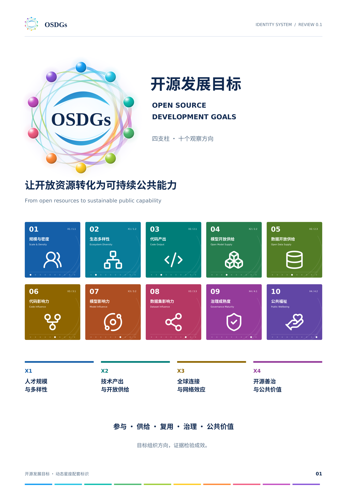

# OSDGs · 开源发展目标

**当前版本：动态星座视觉基线 v2.0.0；报告应用基线 v0.6.0。** 用户于2026-11-06明确通过评审并要求入库。统一中文名为“开源发展目标”。

从[资产目录与选用指南](v2.0/README.md)开始。后续报告、网站、演示和发布材料均从本入口获取，不使用旧概念图重新生成近似标识。

- [主标识与十维资产](v2.0/assets/)
- [应用规则](v2.0/USAGE.md)
- [维度与颜色注册表](v2.0/source/brand_tokens.json)
- [十维CSV](v2.0/source/dimensions.csv)
- [批准范围及PDF校验值](v2.0/approval.json)
- [字体与图标来源](v2.0/RIGHTS.md)

Hero、Standard、Mini是同一个母型的尺度变体，不是三个品牌。D01—D10为十个观察方向的视觉编号，不是新设十章或十个一级目标。

## 配套标识体系 v0.1.0（2026-11-12 已批准）

**[进入四支柱与十维配套标识](identity/v0.1/README.md)**：方形图标、中英文、深浅底、单色、独立透明图形及应用示例。延续上述母版与报告品牌，作为共同的后续复用基线。

[批准记录](../../docs/reviews/2026-11-12-osdgs-identity-v0.1.md) · [资产指纹](identity/v0.1/approved-assets.json)
