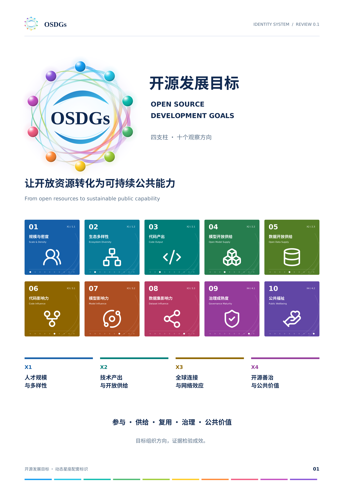

# OSDGs 动态星座配套标识体系 v0.1.0

**已批准基线 · 2026年11月12日。** 对应已评审的 v0.1 方案。与动态星座母版 v2.0.0、GOSD 报告应用 v0.6.0 并列管理，不替代母版或变更维度语义。



## 直接复用

| 用途 | 入口 | 选用建议 |
|---|---|---|
| 四支柱结构 | [pillars](assets/pillars/) | X1—X4 实底、浅底及独立图形 |
| 十维总览 | [dimensions](assets/dimensions/) | D01—D10；zh 为中英双语，en 为英文；solid / light 区分底色 |
| 正文和小尺寸导视 | [icons](assets/icons/) | 彩色、深蓝或白色透明图形，配合编号与名称 |
| 主标与组合 | [原品牌母版](../../v2.0/README.md) | 继续沿用 Hero / Standard / Mini 与既定净空 |
| 五段主线用语 | [narrative.json](source/narrative.json) | 相关观察入口，不是指标等价或因果关系 |
| 颜色、编号与层级 | [品牌参数](source/approved_brand_tokens.json) | 与已批准 v2.0.0 参数一致 |

带 `-outlined.svg` 的文件已将文字转成轮廓，适合跨设备使用；普通 SVG 保留可编辑文字；PNG 用于常规演示。十维方形 PNG 为900×900像素，独立图形为400×400像素。

## 批准与版本边界

本次批准四支柱辅助图形、十维方形构图、节点导视、应用变体与五段主线传播表述。既有名称、编号、颜色、四支柱关系、十个观察方向及母标原件不变。D01—D10不表示十个新增一级目标、权重或认证。

[批准清单](approval.json)记录直接评审决定；[仓库评审记录](../../../../docs/reviews/2026-11-12-osdgs-identity-v0.1.md)说明入库范围。评审页、图形与生成源码逐字保留获批版本，因此仍有历史 REVIEW 字样；后续取用独立资产，以本页和批准清单为当前状态依据。[历史评审说明](REVIEW-NOTES.md)不再代表待审批状态。

## 重建与检查

```bash
python brand/osdgs/v2.0/source/verify_assets.py
python brand/osdgs/identity/v0.1/source/verify_assets.py
```

完整重建方法见历史说明中的“重建”部分；生成器为 [build_identity.py](source/build_identity.py)。`baseline/`保存必要的原版输入，确保本目录可独立复用；字体不随包分发。PDF可本地生成，但不得提交。仓库外评审PDF不因本次批准而改写。

正式印刷仍需按纸张、尺寸和设备打样；建议完整方形图标宽度不小于32mm，更小则采用图形配文字。来源与授权见 [SOURCES](evidence/SOURCES.md)、[原版分发边界](baseline/RIGHTS.md)和 [Lucide许可](baseline/sources/lucide/LICENSE.txt)。视觉批准不代替数据与事实核验，不表示联合国或其他机构背书。
