# 第二章 全球开源生态观测地图（GOSO）

整章评审稿 v1.0.0 · 2026-11-05 · 待作者评审

**02 / GLOBAL OPEN SOURCE OBSERVATORY**

# 全球开源生态观测地图

*参与在扩大，生态的不同层面却并不同步* 如果只看开发者人数，世界开源版图会呈现一种格局；换看协作贡献、项目影响或可复用资产，排序和结构可能随之变化。**理解开源发展，需要把这些侧面放在一起，而不是寻找一张能够代表一切的总榜。**

第一章说明了从开放协作走向公共价值需要哪些条件。本章转向可以观察的参与与资源：谁进入生态，贡献如何汇聚，项目与人才在哪里积累，代码、模型与数据怎样形成供给，以及多元来源如何获得组织与规则的支持。

七节分别承担一个问题，也构成连续的阅读路径：**由参与进入协作，由项目与人才进入资产，再以多样性和治理解释共同建设的条件。**这是一套互补观察，不是一条已经证明的因果链。

本章阅读路径

| 小节 | 主题 | 阅读问题 | 定位 |
| --- | --- | --- | --- |
| 2.1 | 活跃地图 | 参与基础有多大，新增活跃在哪里？ | §2.1 |
| 2.2 | 贡献地图 | 人数之外，协作工作怎样汇聚与连接？ | §2.2 |
| 2.3 | 项目影响力地图 | 贡献来源与项目影响为何呈现不同分布？ | §2.3 |
| 2.4 | 人才地图 | 高影响力参与者在哪里积累和增长？ | §2.4 |
| 2.5 | 资产地图 | 代码、模型与数据形成了怎样的供给？ | §2.5 |
| 2.6 | 多样性地图 | 谁进入共同建设，技术选择怎样变化？ | §2.6 |
| 2.7 | 治理地图 | 谁提供组织支持，参与和复用遵循什么规则？ | §2.7 |

### 三个贯穿全章的观察

**规模与结构分别阅读。**较大规模未必对应较高平均贡献，较快增长也未必提供最多新增量。**归属与来源分别记录。**项目可以归属某一组织或地区，同时由多地参与者共同建设。**数量与条件分别判断。**资产发布、文件覆盖和许可采用，为持续使用提供入口，但不能替代对维护和实际结果的核查。

*整章评审稿 v1.0.0 · 2026年11月5日。主统计期：2025年7月1日至2026年6月30日；历史快照、外部观察和条件估算随图标明。*

## 阅读说明：先分清对象，再比较数字

本章尽量用直观图表呈现差异。以下概念用于区分观察对象，读者无需掌握算法细节，也可以沿着地图、排行和趋势理解主要发现。

### 人、项目与资产

**开发者与活跃开发者。**前者描述积累起来的参与基础，后者指在统计期内发生了纳入规则的协作。一个人可能使用多个平台，也可能某年活跃、某年暂停；人数净增不等于首次参与人数。

**仓库与项目。**仓库是存放代码、版本及协作记录的空间；一个项目可能包含多个仓库，也可能跨平台托管。代码仓库、模型条目和数据集条目是不同资产，不能直接相加成为独立创新成果数。

### 协作、贡献与影响

**修改请求（PR）与问题记录（Issue）。**前者是请求项目接纳的一组修改，后者用于记录问题、需求或讨论。提出、审阅、讨论和维护，都可能构成协作的一部分。

**OpenRank。**它依据协作关系观察网络位置，而不是只累加事件次数。开发者贡献度与项目影响力的对象和聚合方式不同；本章保留源表定义，不把两者相除为效率，也不把得分视为质量或社会价值认证。\[13\]\[12\]

### 读数与图形

**总量、均值与份额。**总量回答“有多少”，均值说明相对于指定分母的差异，份额说明占某一合计的比例。份额从10%到12%，增加的是2个百分点、相对增幅为20%，两种表达不应混用。

**地图、条形与流带。**地图帮助定位，条形便于比较大小，趋势图显示时间变化。桑基图的带宽表示连接数值；本章贡献流带表示OpenRank贡献度，不表示人员迁移或资金流动。未知与未列不按零处理。

### 本章的比较范围

五域固定比较欧洲、美国、中国、印度与南方六国代表组，后者由巴西、印度尼西亚、越南、菲律宾、埃及和南非组成。欧洲沿用各表范围；五域不是对世界的完整划分。中国省级观察纳入台湾、香港和澳门。

*各图保留具体对象、窗口与关键分母。下载只是使用信号；高影响力人才沿用源表筛选，并非完整能力评价。详细来源与方法见章末，生产端待核事项另存核查包。*

## 2.1 全球开源活跃地图（V-Map）

*参与基础在扩大，活跃与增长呈现不同格局*

开源协作从人的参与开始。一个地区积累了多少开发者，当期有多少人实际参与，新增活跃又发生在哪里，是三个彼此相关、却不能相互替代的问题。本节由全球进入五域与中国省级地区，观察参与规模、增长节奏和平台覆盖。

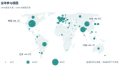

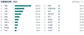

**图 2-1-1 全球活跃参与的空间分布与前20个国家读数**

据归档GitHub口径，2025-07-01—2026-06-30。底图未匹配项不作零值，圆心仅用于定位。[1]

## 2.1.1 全球参与：进入生态与持续活跃并不同步

2026报告年度，归档记录中的开发者总量约为**1.94亿**，活跃开发者约为**2,890万**。总量反映长期积累的参与基础，活跃人数则反映当期发生了纳入统计的协作。两者均在扩大，但增长速度并不一致。[1]

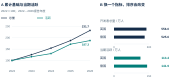

**图 2-1-2 参与基础与当期活跃：相对增长和地区排序的双重观察**

2022—2026报告年度，开发者总量增至期初的**2.32倍**，活跃人数增至**1.87倍**；最近一年分别增长23.7%和9.3%。地区排序也有所不同：英国的开发者总量高于德国，当期活跃人数却较少。较大的参与基础，不会自动转化为同等规模的当期协作。

累计基础保留了过去进入生态的人，当期活跃还受到首次参与、持续参与、回流与暂停参与共同影响。因而，活跃增速较低不能直接解释为参与意愿下降，也不能由两个年度汇总值推算同一批人的留存率。

AI进一步增加了解读这类变化的必要性。同一个人借助工具完成更多工作，活动次数会上升，在去重人数中却仍只计一次。GitHub的外部观察提供了活动加速的背景，详见2.5节；本节不据此判断AI对人数增长的净影响。[5]

## 2.1.2 五域比较：规模之外，还有覆盖差异

五域比较显示，欧美中已形成相近的开发者基础：三组总量均接近3,000万。当观察转向实际活跃，欧洲居首，美国与中国较为接近。参与基础与当期协作因此需要分别比较，不能用一张总量排行概括。[2]

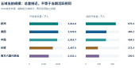

**图 2-1-3 五域开发者总量与当期活跃规模**

平台覆盖还会改变可见的参与格局。GitHub口径下，中国约有250.48万活跃开发者，低于印度的285.09万；按编制组另行登记的约120万本土平台去重补充量，中国观测规模约为370万。它说明本土平台承载的参与不宜忽略，而非建立新的统一全球排名。[3]

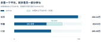

**图 2-1-4 扩大平台覆盖后，部分参与力量才进入视野**

覆盖比较中，美国和印度仍仅含GitHub；中国补充量来自Gitee、AtomGit等平台资料与问卷记录，其去重执行待核。不重复加入五域表，也不按比例分配至省份。

## 规模中心与成长中的社区，需要不同的观察

已有规模决定当前可见的参与基础，相对增幅揭示各组相对于自身起点的扩张。将两种排序并列，能避免只看大群体而忽视较快成长的社区，也避免只看高增幅而忽略基数。[2]

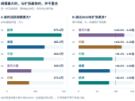

**图 2-1-5 五域活跃规模与相对扩张：两种排序，两类观察**

欧洲的当期活跃规模最高，南方六国代表组和印度的累计扩张更快，分别达到2022年的**2.23倍与2.16倍**。中国约为1.91倍，最近一年增长42.0%。不同排序提示，国际合作既可以连接已有中心，也可以关注成长中的参与群体。

“南方六国代表组”固定指巴西、印度尼西亚、越南、菲律宾、埃及和南非，不代表整个全球南方。五域也是比较组，而非对世界的完整划分。具体合作仍需落到项目需求、维护团队与当地条件。

## 2.1.3 中国省级观察：头部集聚，多地参与

中国省级分布呈现明显的规模梯度。34个省级地区中，京沪粤合计约**131.7万**活跃开发者，占省级合计的**52.6%**。台湾、浙江、江苏、四川与湖北等地则构成头部之外的重要参与节点。[4]

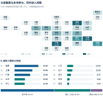

**图 2-1-6 中国34个省级地区的活跃分布、前10地区与结构份额**

前三地之外，第4—10位地区合计占约36.0%，其余24地占约11.5%。地图和排行共同呈现出“头部集聚、多地参与”的结构；不能将后两组的参与简单视为可以忽略的余量。

这种梯度为区域支持提供了不同起点。头部地区可进一步关注密集参与背后的维护需求，其他地区则可结合当地项目与人才条件拓展协作。地域相邻或规模接近，本身并不证明已经形成跨地区合作网络。

2026报告年度，GitHub省级记录；本土平台补充量未分配至省份。图谱表示近似方位，不表达行政面积、人口密度或个人位置。

## 中国省级增长：新增活跃与既有规模

2026报告年度，省级活跃人数较上年净增约**30.4万**。京沪粤贡献了过半净增量；台湾与浙江的净增量份额则高于其当前规模份额。比较这两种份额，可以辨认总量排行没有充分呈现的增长差异。[4]

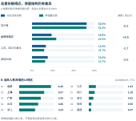

**图 2-1-7 各地区组的活跃规模份额、净增量份额与净增前10地区**

台湾与浙江的净增量份额高出规模份额约**4.5个百分点**；京沪粤两项均约为52%。四组人数都在增加，增量份额较低并不等于人数下降。下方净增排行进一步说明，北京、上海和广东仍提供了最大的绝对增量。

从已有规模到新增活跃，问题由“参与在哪里”推进到“变化发生在哪里”。这为下一节的贡献观察奠定基础：参与扩大之后，哪些工作进入了项目的共同建设？

两类份额分别以34地活跃合计和净增合计为分母；净增不等于首次参与人数。

## 2.2 全球开源贡献地图（C-Map）

*人数之外，看见协作工作的分布与连接*

开发者参与可以表现为提出问题、改进代码、审阅修改或维护版本。人数告诉我们有多少人进入生态，贡献地图进一步观察这些工作在哪里汇聚、与哪些项目相连。全球分布、五域变化、中国区域与项目来源，共同构成本节的四个观察层次。

本节沿用数据源的“开发者OpenRank贡献度”。它根据协作关系衡量网络中的贡献位置，不是代码行数或提交次数的简单合计，也不是对个人能力的评分。规模、平均值与来源关系分别提供不同线索。[12][13]

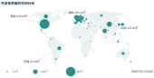

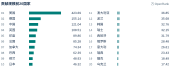

**图 2-2-1 全球开发者贡献的空间分布与前20国家**

2025年OpenShare地理快照；单位：OpenRank。地图按236个地域记录匹配底图，未匹配项不作零值。[7]

## 2.2.1 全球贡献：参与规模与贡献强度不完全对应

在同一份2025年地理快照中，美国、德国和中国的贡献规模位列前三。德国的活跃人数位列第5、贡献位列第2；印度的相应位次为第2和第5。**人数排序与贡献排序并不重合**，说明参与规模不能替代对协作结构的观察。[7]

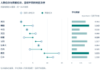

**图 2-2-2 贡献规模前10国家的活跃位次、贡献位次与平均贡献**

在贡献规模前十国家中，德国与荷兰的平均贡献分别约为1.143和1.131 OpenRank／活跃开发者，印度与巴西分别约为0.329和0.335。比值由地区总量计算，表示相对于同表活跃人数的贡献强度，不是当地每个人的实际得分。

参与角色、项目构成、持续协作以及少数高贡献者的分布，都可能影响这一差异。汇总表不能分离这些因素，更不能据平均值评价代码质量、开发效率或地区人才素质。[13]

对合作伙伴的识别而言，规模提供搜索范围，贡献强度提供进一步了解项目与社区的线索；两者适合结合使用，而不宜合成一个笼统的地区实力分数。

贡献度与活跃人数取自同一2025快照；位次对照不是跨年排名变化。[7]

## 2.2.2 五域比较：规模与增长呈现不同次序

2026报告年度五域表中，欧洲的开发者贡献度约为**650.16万OpenRank**，中国与美国分别为442.92万和423.97万。中国在本表高于美国约18.95万，但这一比较仅指特定口径的协作贡献，不扩展为整体技术实力判断。[8]

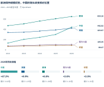

**图 2-2-3 五域贡献规模的年度轨迹、当期读数与增长幅度**

2026报告年度为2025-07-01至2026-06-30；累计倍数以各组2022年为起点。[8]

2022—2026报告年度，中国贡献度增至起点的**3.32倍**，最近一年增长47.2%；欧洲与美国分别为期初的1.38倍和1.25倍。欧洲保持较大的贡献规模，中国较快的增长则改变了本序列中的相对位置。

南方六国代表组与印度分别为期初的1.32倍和1.31倍。与2.1的活跃人数增长对照，贡献与人数并未同步扩张；由于对象、覆盖及指标仍需逐项对齐，这种差异适合提出研究问题，不宜直接计算跨表的“转化效率”。

五域沿用固定比较组，窗口为2025年7月至2026年6月；与2025自然年地理快照分别阅读。

## 2.2.3 中国区域：贡献规模呈现分层集聚

中国省级贡献同样呈现集聚，但次序与活跃人数并非完全一致。2025年快照中，京沪粤合计约**64.07万OpenRank**，占34地合计的52.9%；浙江与台湾分别超过14万，江苏、四川、湖北等地也形成了可观的贡献规模。[9]

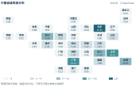

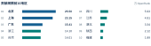

**图 2-2-4 中国34个省级地区的贡献分布与贡献规模前10地区**

2025年OpenShare省级快照。色阶与排行均使用贡献度；台湾、香港、澳门纳入34地统计。[9]

京沪粤与浙江、台湾五地合计占76.2%，其余29地占23.8%。这一分布刻画贡献在何处汇聚，并不说明贡献仅在本地项目中发生。理解区域作用，还需要结合参与者所连接的项目及其维护任务。

## 平均贡献：规模比较之外的补充视角

对贡献总量前十地区，以同表活跃人数为分母，平均贡献形成了另一种次序。浙江、台湾、上海与四川分别约为**0.655、0.644、0.605和0.540**，均高于34地合计计算的0.516；北京总量最大，相应平均值约为0.495。[9]

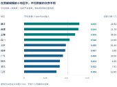

**图 2-2-5 贡献总量前10地区的平均贡献与活跃人数**

平均贡献＝地区贡献度／同表活跃开发者数；所选十地并非全国平均贡献前十榜。[9]

总量与平均值的差异，可能来自学习者、偶发参与者、持续贡献者的组合，也可能来自所参与项目及其协作方式。平均值能够提示值得深入了解的结构，却不能替代对个人工作与项目质量的核查。

因此，区域支持既不应只奖励“大体量”，也不宜只追求“高均值”。更具体的问题是：贡献者承担哪些工作，评审和维护是否得到支持，不同阶段的参与者能否持续获得机会。

各地区比值采用同一2025年省级快照；未列地区不表示零贡献。[9]

## 2.2.4 协作连接：项目归属不等于贡献来源

项目归属地与开发者所在地描述的是两类对象。一个由某地组织发起的项目，可以由不同地区共同建设。中美项目来源前十表记录**20条关系、14个来源国家**，为观察这种联系提供了具体样本。[10]

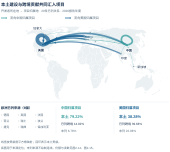

**图 2-2-6 中美项目样本的全球贡献连接**

2026报告年度；中美项目来源前十样本。连线方向为开发者所在地至项目归属地。[10]

已列来源横跨北美、欧洲与亚洲。中美开发者均参与对方归属项目，加拿大、德国、英国和印度等来源也同时出现在两组记录中。地图说明贡献来自哪里，下一页再比较这些来源在各自样本中占多少。

这里的连线表示协作贡献，而非人员迁居、资金转移或软件使用流向。两端的地域标签都必须保留，才能避免把“项目在哪里”误写成“所有工作由哪里完成”。

## 来源结构：本土与跨境贡献的不同组合

将每组项目样本分别设为100%，可在同一份额尺度下比较来源构成。图中区分本土、对方国家、其余已列国家与未列来源；两侧图形等高只表示各自的完整份额，不表示两组贡献总量相同。[10]

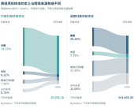

**图 2-2-7 中美项目样本的贡献来源结构（各自样本＝100%）**

2026报告年度；带宽与原表份额线性对应，“其余已列8国”为各组其余八条记录的合计。[10]

中国归属项目的本土贡献占79.22%，已列跨境贡献占14.02%；美国归属项目分别为38.28%与39.66%。前者更多由本土来源支撑，后者的已列跨境来源占比更高。

未列来源分别占6.76%与22.06%，不分配至具体国家。来源构成刻画样本结构，不能单独评价项目开放程度、合作持续性或治理质量；这些问题还需项目规则、参与过程与长期记录。

## 来源明细：跨境联系与贡献读数

具体读数进一步揭示了双向参与。中国归属项目最大的已列境外来源是美国，美国归属项目最大的已列境外来源是中国，其后为德国、英国和加拿大。[10]

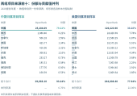

**图 2-2-8 中美项目样本的贡献来源前十及原表份额**

2026报告年度；单位：OpenRank。份额分母为各自项目样本，未列来源的贡献值不反推。[10]

中国来源对美国项目的贡献为**24,420.69 OpenRank**，反向为1,980.46，约相差12.3倍。这是本表指定方向的比值，而非两国全部贡献之比，亦不表示国家净输出。

贡献地图由规模走向关系，说明持续合作不止于项目的发布或归属。支持可以进一步落到评审、问题响应与共同维护；下一节转向项目影响力，考察这些协作在项目层面形成怎样的网络位置。

本表与2.6的60条扩展关系表不是同一样本；数值和份额分别保留，不拼接汇总。

## 2.3 全球开源项目影响力地图（I-Map）

*协作汇聚为项目，影响分布未必与贡献来源相同*

参与与贡献最终进入具体项目，但项目的网络影响不会简单复制开发者所在地的分布。本节从全球归属、五域变化与中国项目样本展开，观察影响力在哪里集聚，并将归属地、贡献来源和参与规模放在各自的位置上理解。

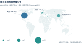

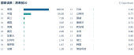

**图 2-3-1 项目影响力的地域分布与前20国家读数**

来源：OpenDigger / OpenShare，2025自然年；沿用原表30国标签，未列项不作零值。[14]

本节“项目”沿用数据源的对象边界，可能包含一个或多个仓库。项目影响力使用OpenRank衡量协作网络中的位置；它提供识别关键节点的线索，不直接代表产品质量、用户规模或经济价值。[13]

## 2.3.1 全球分布：集中格局与组织线索

2025自然年归档的30个国家标签中，项目影响力合计约**273.91万OpenRank**，美国与中国合计占88.8%。这一集中度首先反映已纳入标签统计的项目结构，不能据此推及全部开源资源的归属。[14]

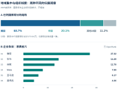

**图 2-3-2 国家标签得分结构与企业条目读数**

原企业榜前六为微软、华为、谷歌、Meta、亚马逊和英伟达。企业条目为理解项目背后的组织提供入口，但国家与企业是不同归属视角，不能将两类得分相加。[14]

较高网络得分通常使项目值得进一步关注；支持重点仍须落实到维护需求、外部参与及实际依赖。对于一项目多仓库、基金会托管和组织发起等情形，还需核对历史映射，不能仅凭当前名称重分历史得分。

本节沿用原表项目与地域标签；项目—仓库边界、跨平台去重及地域汇总的生产版本尚待补齐，不据现有标签重新划分历史分数。

## 2.3.2 五域比较：贡献投入与项目影响力的地域差异

开发者贡献较多的地区，是否也具有较大的项目影响力？五域比较给出了不同排序：欧洲在贡献度中居首，美国在项目影响力中居首，中国两项均居第二。两项指标分别观察协作者投入与项目网络位置。[15]

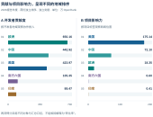

**图 2-3-3 五域开发者贡献度与项目影响力的独立排序**

来源：编制组五域底表，2025-07-01—2026-06-30。

欧洲贡献度约650.16万、项目影响力约18.35万OpenRank；美国分别约423.97万与175.14万。它们不是同一数量的流入和流出，不能相除为“贡献转化率”，也不能用其差额计算净收益。

这一差异与2.2的跨境连接相互提示：开发者可以持续建设归属其他地区的项目。同时，项目标签覆盖与组织归属规则也会改变汇总结果。真实协作结构与统计覆盖各自解释多少，仍需项目级证据。

印度与南方六国代表组在本表的项目得分较小，不等于其开发者能力或本地创新较弱。对较少被标签覆盖的地区，补齐项目清单应先于扩展判断。

## 项目影响：同时观察规模与相对变化

五年间，美国保持项目影响力的规模优势，中国相对增长较快。2022—2026报告年度，中国由27.74万增至72.10万，美国由134.19万增至175.14万。不同起点使绝对差额与相对位置呈现不同变化。[15]

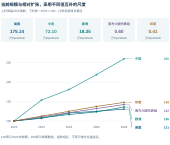

**图 2-3-4 五域项目影响力轨迹与累计增幅**

中国得分相当于美国的比例由**20.7%升至41.2%**，但绝对差距并非逐年缩小。统一基期的指数显示扩张幅度，原始读数保留量级，两者应一起阅读。

高存量与快增长对应不同的支持问题：前者需要了解已有依赖与维护连续性，后者需要考察增长中的协作安排能否跟上。区域曲线不能替代对具体项目的判断。

增长指数以各组2022年为100，五组使用共同尺度；当前得分另列。

## 2.3.3 中国观察：头部项目与样本结构

中国30项项目样本提供了比地域汇总更具体的观察。OpenHarmony与openEuler得分居前，两项合计占条目得分的**53.7%**；前十项合计占84.3%。前15项读数与完整30项的分组结构共同呈现了样本层次。[15]

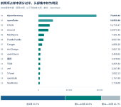

**图 2-3-5 中国项目样本的前15项读数与30项得分结构**

分母为原表30项条目得分合计17.63万OpenRank；不是全国项目影响力总量。

头部集中提示应进一步关注关键项目的维护连续性，但单期样本不能说明这些项目贡献了全国增长的多少，也不能把样本以外的项目视为不存在。

稳定关键项目与支持成长项目并不矛盾。前者可重点检查依赖和维护缺口，后者可结合真实用途、外部反馈与共同建设条件确定支持方式。

## 项目影响力与参与规模，提供互补的观察

在样本影响力前十项中，按活跃人数重排后，CANN与Ascend次序互换，Cangjie与openGauss也出现不同位次。**参与人数与网络影响提供的是两种信息**，不宜互相替代。[15]

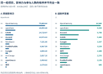

**图 2-3-6 中国样本前十项的影响力与活跃开发者排序**

人数回答参与规模，网络得分还涉及协作关系与历史积累。得分除以人数并不等于开发效率；是否形成可靠成果，还需质量、采用与维护证据。[13]

公开标签显示，OpenHarmony与openEuler关联多个平台组织，AgentScope以GitHub组织为入口。这说明项目未必等于单个仓库，也提醒跨平台汇总必须保留去重与归属依据。[17]

因此，项目支持应落到具体的维护团队与工作，而不只看归属标签。下一节由项目回到人，观察网络影响较高的参与者在不同地区怎样积累与变化。

## 2.4 全球开源人才地图（T-Map）

*观察高影响力参与者的地域积累与变化*

稳定的开源项目需要人的长期投入。人才地图将视角从项目转向参与者，观察高影响力群体在全球、五域及中国城市的分布，并区分已有规模、净增人数与相对增幅。

样本沿用源表“个人全域OpenRank前5%”的定义，反映协作网络位置，而非完整的人才能力评价。前5%的比较总体、得分窗口和并列处理仍待核验，因此人数变化也不能直接解释为培养成效。[19][13]

### 2.4.1 全球分布：规模中心与广泛节点

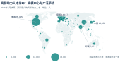

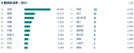

**图 2-4-1 高影响力人才的全球分布与前20个国家读数**

全球图沿用2026年7月快照；其他年度比较另用报告年度底表。未收录地域不记为零，地域记录不据此推算全球人才总量。[19]

## 2.4.2 五域比较：人才积累与当期变化

在固定五域年度序列中，欧洲保持最大的样本规模。该序列用于比较各组长期积累，与前页2026年7月的全球快照分别阅读，不由两者推算覆盖率。[20]

2026报告年度，欧洲为**58,000人**，美国35,000人，中国13,100人；南方六国代表组和印度分别为9,032人与7,515人。五组较2022年均有增加，当前规模仍呈明显梯度。[20]

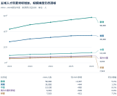

**图 2-4-2 五域高影响力人才的年度积累与当期变化**

较大的群体提供了寻找同行与项目的广泛基础，较小群体则不应因规模而被排除在合作之外。参与者能否获得真实任务、评审反馈和维护机会，需要在地域数量之外继续观察。

五域采用固定比较组，南方六国的成员范围见章首阅读说明；该表不用于推算全球总人数。

## 增长的两种尺度：净增人数与相对幅度

2026较2025报告年度，欧洲净增**2,867人**，中国净增**982人**；中国同比增幅8.1%，为五组最高。净增人数与相对增幅分别回答增加了多少、扩大得多快，因而排序可以不同。[20]

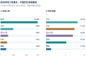

**图 2-4-3 五域人才净增与同比增幅：不同基数下的两种排序**

中国人数相当于美国的比例从2022年的35.1%升至2026年的37.4%。整个区间的中美人数差额仍扩大，但最近一年缩小538人。一个区间的累计变化，不能概括每一年的方向。

对人才支持而言，两种尺度相互补充：已有中心承接的新增需求较多，较快成长的群体也可能需要更稳定的合作条件。判断仍须回到参与和工作机会，而非单凭增幅。

## 2.4.3 中国城市：规模中心与成长节点并存

中国固定十城样本进一步呈现了城市间的差异。2026报告年度，十城合计**3,590人**，北京与上海合计占52.5%；杭州、深圳和台北居其后，成都、广州、武汉、南京与苏州也各有一定规模。[21]

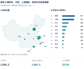

**图 2-4-4 中国固定十城的人才位置、人数排行与样本结构**

这是对固定十城的观察，不是全国城市完整排名。点位表示城市位置，不能据其推算人才密度、迁入人数，或将未列城市视为没有人才。

规模中心与其他节点可为区域合作提供不同入口，但地图上的接近不等于已经发生协作。连接是否稳定，还需共同项目、任务分工与持续维护记录。

样本范围固定为原表十城；台北纳入中国城市观察。地图锚点表示城市中心，不表示个人位置。

## 城市增长：头部贡献更多增量，较小节点也在扩大

2022—2026报告年度，十城合计净增**722人**，北京与上海合计贡献49.3%的净增量。武汉与成都的累计增幅较高，分别为45.8%和43.7%，对应增加33人与55人。[21]

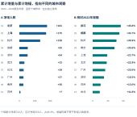

**图 2-4-5 固定十城的累计净增人数与相对增幅**

最近一年则是上海净增118人最多、杭州增幅17.4%最高。比较长度不同，增长重点也会变化。因此，既要看长期积累，也要看近期变化，避免只凭一个增长率选取合作对象。

本节支持的行动是扩大真实任务、导师评审与维护时间的供给，而非按个人网络得分作全面能力判断。人的持续投入还会沉淀为代码、模型与数据；下一节转向这些可继续使用的开放资产。

## 2.5 全球开源资产地图（A-Map）

*供给加速扩张，发布之后的工作同样重要*

代码、模型与数据集，是协作留下的可继续使用和改进的成果。AI改变了生成与发布的节奏，也使供给观察需要区分：产生了多少活动，积累了多少资产，以及这些成果能否被理解、采用和维护。

GitHub 2026年报显示，代码提交、合入修改请求及公共贡献均显著增加。本图保留三类计数，作为理解工作节奏的外部参照；它们不是独立项目数，也不能直接换算为生产率。[5]

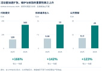

**图 2-5-1 GitHub官方观察：代码活动的扩张及其不同计数对象**

来源：GitHub Octoverse 2026。2026标签指截至2026-09-30的12个月；对比数值沿用该报告口径，与GOSD年度资产存量分开呈现。

资产地图由此先观察代码供给，再看模型与数据。官方研究解释平台变化，本报告样本补充地域与用途结构；技术分类估算则单独标识，用于探索结构，不作为已测得的类别事实。

## 2.5.1 代码资产：规模与增长分别观察

2026报告年度，四个平台的活跃仓库记录均较上年增加。GitHub为**632.86万个**，Gitee为438.89万个，AtomGit和GitLab分别为60.41万个与11.78万个。规模排序并不等于净增排序。[22]

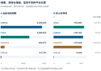

**图 2-5-2 四平台活跃仓库规模、同比净增与增幅**

来源：报告编制组原表。2026报告年度为2025-07-01至2026-06-30；GitCode按既定口径显示为AtomGit。

Gitee净增51.40万个，略高于GitHub的49.75万个；AtomGit净增47.58万个，与前两者接近，但较小基数使其同比增幅达到371.0%。判断扩张应同时看当前规模、净增量与基数。

## 沿时间观察：年度回升与长期扩张有所不同

五年序列补充了单年比较看不到的路径。GitHub与Gitee的活跃仓库记录逐年增加，累计均增长约30.3%；GitLab在2026年同比回升5.2%，但仍比2022年低约9.6%。[22]

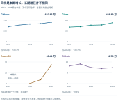

**图 2-5-3 四个平台的活跃仓库历史路径**

来源：报告编制组原表。AtomGit在2022、2023年无值；独立纵轴用于辨认各平台路径，不用于比较曲线的视觉陡峭程度。

活跃净增不等于新建仓库。既有仓库重新发生协作，会进入当期活跃集合；暂停协作则可能退出。平台收录和判定规则也会影响结果，因此不能将净增全部解释为新项目创建。

四平台记录合计1,143.94万个，反映各平台的观察范围，而非跨平台去重后的全球独立项目总量。对供给的进一步判断，应结合持续维护、版本更新与实际使用。

## 技术结构估算：在已知总量下观察可能的组成

去年技术地图提供了12类、合计**13,103项**项目分类数量。本图将其比例作为基准，按2026年GitHub活跃仓库总量分配，给出“结构延续”条件下的类别规模。使用的是项目数量比例，不是OpenRank影响力比例。[23][22]

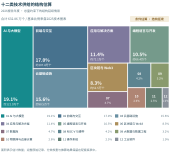

**图 2-5-4 2026年十二类技术资产结构估算：历史比例与总量约束**

来源：去年技术图表数量字段、本报告GitHub活跃仓库总量。外推假设与方法见统计说明。

在“项目样本可代表仓库总体、类别不重叠且比例不变”的假设下，AI与大模型约121.0万个，占19.1%；前端与交互约107.4万个，云基础设施约98.5万个。**这些是假设下的估计，不是2026年实测分类。** 样本偏差、一项目多仓库及多标签关系均可能改变结果。

## 分类增长：用情景比较辨认结构敏感性

总量净增49.745万个，并不能唯一确定增长落在哪些类别。结构延续基准使各类同增约8.53%；另一组情景则假设AI相关类别增幅较高，并使其他类别的增长与总量保持平衡。

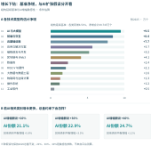

**图 2-5-5 十二类估计净增量与AI扩张敏感性分析**

计算：结构延续分配及总量平衡。AI参数是情景假设；类别明细、公式与未舍入结果见配套底表。

AI增幅分别设为20%、30%和40%时，估计份额为21.1%、22.9%和24.7%，其他类别的平衡增幅相应为5.8%、3.5%和1.1%。它们展示假设的影响，不代表实际技术增速、预测区间或最可能结果。估算用于确定后续分类核查的重点。

## 2.5.2 模型资产：目录扩大，可用供给也在重组

Hugging Face（HF）是模型、数据集与应用演示的重要托管平台。其2026年夏季观察记录，公开模型仓库由约243万增至296万，数据集由71.1万增至100万，应用展示空间（Spaces）由100万增至144万。目录扩张也包含适配、格式转换与试用入口。[24]

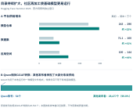

**图 2-5-6 HF官方观察：平台供给增长与模型再加工的参与主体**

来源：HF Summer 2026固定文本。原文总体观察为2026年1—8月，部分分析止于7月；期初／期末数值为约数。Qwen转换统计按原文独立范围呈现。

原研究列出的28,531个Qwen相关GGUF转换条目中，Qwen账号发布54个，其余由其他账号发布。GGUF是一种便于相关运行工具加载模型的文件格式；转换记录说明，**基础发布与后续加工由不同参与者共同完成**。[24]

条目增加并不自动意味着新增独立能力，适配能降低哪些门槛仍需具体核查。下面以发布单位样本观察地域供给；模型家族、派生关系与开放条件留待第五章系统展开。

## 模型地域：全球平台之外的发布单位观察

本报告沿用的发布单位累计样本覆盖63个国家和地区、826家发布单位，共有**72,280个模型条目**。美国为45,801个、中国6,017个，法国、德国、芬兰和英国等地也形成了可识别的供给节点。该样本补充的是发布方结构，不是平台全量。[25]

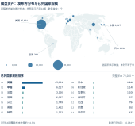

**图 2-5-7 模型发布单位样本的地域分布与数量排序**

来源：原稿Hugging Face发布单位累计样本。快照日期未注明；不作为本报告主统计期的年度新增量。

欧洲已列六国合计10,084个，占完整样本14.0%；已列14国覆盖样本数量的94.3%。欧洲小计只包括原表已列成员，其余地域保留在总体分母中，不视为没有供给。

发布方所在地不同于模型使用者所在地。样本快照日期尚未注明，因此不与官方平台总量相除求覆盖率，也不改称本报告年度新增量。

## 模型使用：数量、下载与任务各有侧重

同一发布单位样本中，美国模型的数量与下载份额分别为63.4%和73.9%，中国分别为8.3%和12.6%。中国下载份额高出数量份额约**4.3个百分点**，显示发布积累与下载信号并非按相同比例分布。[25]

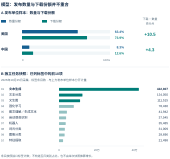

**图 2-5-8 模型数量与下载份额，以及独立任务快照**

A：原稿发布单位样本；B：2026-10-15采集的独立任务分布。两个面板不共享样本总量。

独立任务快照从用途补充这一观察：文本生成条目最多，文本分类、图像生成与语音识别等也各有规模。任务标签记录资源如何被描述，不直接评价技术水平或需求满足程度。[26]

下载计数可能包含重复与自动化请求，不等于独立用户或生产部署。不同库、格式与文件请求的规则也会影响读数，因此这里只将它作为受统计口径约束的使用信号。[27]

## 2.5.3 数据资产：发布结构与模型并不相同

数据集与模型的供给结构并不相同。发布单位样本中的**12,291个数据集条目**，包括美国5,871个、中国1,338个；德国、法国和爱尔兰等地亦位于已列国家前列。[25]

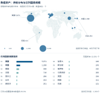

**图 2-5-9 数据集发布单位样本的地域分布与数量排序**

来源：原稿Hugging Face发布单位累计样本。快照日期未注明；地域表示发布方归属，不表示数据采集或使用地点。

欧洲已列五国合计2,359个，占完整样本19.2%。德国与爱尔兰在数据集数量表中的位次高于模型表，提示不同类型资产需要分别观察，不能由模型供给概括整个开放生态。

可复用的数据还需要来源、许可、字段与任务说明。数据卡提供这些信息的结构化入口，帮助使用者判断适用性；发布数量本身不能替代材料检查。[28]

## 数据使用：任务变化带来新的供给需求

美国数据集的数量与下载份额分别为47.8%和82.6%，中国分别为10.9%和4.7%。中国下载份额低约**6.2个百分点**，与模型样本形成对照，说明不同资产的使用结构不可互相推断。[25]

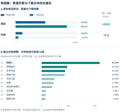

**图 2-5-10 数据集数量与下载份额，以及独立任务快照**

A：原稿发布单位样本；B：2026-10-15采集的独立任务分布。任务标签可重叠，不作为互斥资产类别。

独立任务快照中，机器人标签条目居首；HF春季研究另记录该类数据集由2024年的1,145个增至2025年的26,991个。两套资料都提示新任务带来的供给需求，但不拼接为同一连续序列。[29][30]

从代码、模型到数据，支持重点不应停留在发布量。版本、说明、测试、反馈与维护决定成果能否被接续使用。下一节观察这些供给背后的参与来源和技术选择，进一步辨认谁进入了共同建设。

## 2.6 全球开源多样性地图（D-Map）

*由规模转向构成，看见不同来源与技术选择*

前五节分别观察参与、贡献、项目、人才与资产。多样性地图进一步询问：这些活动由哪些来源构成，哪些技术社区正在扩张，合作是否连接多个地区。本节聚焦有定义、有来源的维度，不构造笼统的多样性总分。

### 2.6.1 全球来源：从主要节点看向更广泛的参与

在2025自然年贡献快照中，固定五国——美国、德国、中国、英国和印度——之外，法国、加拿大、巴西、荷兰、日本等地也提供了可观贡献。展开头部之外的来源，有助于避免把生态理解为少数中心的集合。[7]

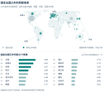

**图 2-6-1 全球贡献分布与固定五国之外的主要来源**

来源：OpenDigger／GOSD归档，2025自然年快照。排行份额以已列236个地区的贡献合计为分母。

## 总体构成稳定，年度份额变化并非单向

2022—2026报告年度，固定五国的合计份额由49.47%变为48.62%，总体变化较小。逐年展开后，各来源的调整路径则明显不同。构成条保留当期结构，变化矩阵区分每年的升降。[34]

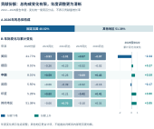

**图 2-6-2 贡献来源的当期构成、逐年变化与累计变化**

来源：报告编制组份额表，2022—2026报告年度。热力色深共用尺度，表示年度变动幅度；右栏为2026较2022的百分点差额。

最近一年，中国与印度分别回升**0.43和0.41个百分点**，美国下降0.97个百分点。中国2025年下降后回升，美国2025年上升后回落，说明年度调整并非持续的单向转移。

五年累计，美国下降2.34个百分点，印度上升0.80个百分点，其他地区合计上升0.85个百分点。其他地区仍是集合，不能据此判断新增了多少国家；份额升降也不同于贡献总量增减。

## 技术参与：2026年语言社区的规模与扩张

地域之外，编程语言提供了观察技术参与的另一条线索。GitHub Octoverse 2026显示，TypeScript、Python与JavaScript的月度参与规模保持前三；2025年9月至2026年9月，分别净增约362万、323万与182万月度贡献者。[5]

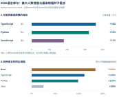

**图 2-6-3 2026年主要语言的月度贡献者增量与部分语言同比增幅**

来源：GitHub Octoverse 2026正文及官方图。2025年9月至2026年9月；默认含公私仓，账号可跨语言重复。仅绘制已明确公布的值，不使用2027年预测。

人数增量最大的是TypeScript，官方所列主要语言中同比增幅最高的是Rust，达到162%；TypeScript、Python和Java分别为134%、118%与30%。较小社区可以更快扩张，大型社区仍可能增加更多参与者。

月度贡献者包括在对应语言仓库中推送、提出问题、提交修改和参与评审的去重账号，不仅是直接写代码的人。账号可同时参与多种语言，不能把各语言人数相加为独立总人数。

## 工具使用与仓库结构：关联存在，机制仍需辨认

工具使用与技术选择也呈现关联。GitHub同时观察了各语言已合入修改请求中的可检测AI参与比例，以及不同仓库群体的主语言构成。前者描述工作流程，后者描述代码组织，分母不同。[5]

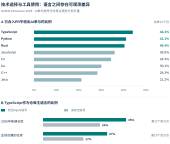

**图 2-6-4 不同语言的AI参与信号与TypeScript仓库构成**

来源：GitHub Octoverse 2026官方图及正文，观察至2026年9月。上图以各语言已合入PR为分母；下图以相应仓库组为分母。检出比例不代表AI生成代码占比。

所列八种语言中，AI检出比例介于Java的21.2%与TypeScript的44.1%之间。这里识别的是可见信号，不是AI生成代码的比例；未检出也不能判为没有使用AI。

2026年新建仓库中，有Agent信号者35%以TypeScript为主语言，无该信号者为24%；此前创建的仓库分别为27%与17%。差异提示工具与技术选择值得联合研究，但不能排除项目用途、团队经验和框架选择等因素。

## 2.6.2 中美对照：跨境份额与来源构成分别观察

2.2已说明中美项目的本土与跨境结构。本节沿用同一来源前十表，进一步观察已列海外贡献由谁构成：中国项目的已列跨境份额为14.02%，美国为39.66%；未列来源继续单独保留。[35]

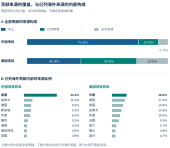

**图 2-6-5 中美项目的来源覆盖与已列跨境贡献内部构成**

来源：中美项目来源前十表，2026报告年度。上栏分母为各组全部贡献，下栏为各自已列海外贡献；未列来源保留。

仅以各自已列海外贡献为分母，美国来源占中国项目的44.4%；中国来源占美国项目的19.6%，德国、英国与加拿大也各占较大部分。跨境份额说明海外贡献占多少，内部构成则说明这些贡献由谁提供。

中国样本的已列海外贡献更集中于最大单一来源，美国样本相对分散。该观察只涉及前十表已列部分，完整结构仍受未列来源影响，不能据此推导项目吸引力或治理优劣。

## 2.6.3 贡献连接：同一来源可支持多地项目

另一份扩展关系表覆盖14个来源和10个项目归属地区。本页选取其中进入中美项目的20条，用统一尺度呈现本土支持与跨地域参与；它与2.2的来源前十表是独立样本，不能用两表差额解释变化。[36]

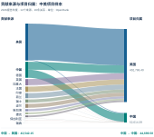

**图 2-6-6 中美项目样本的跨地域贡献连接**

来源：60条归档关系中进入中美项目的20条，2026报告年度。带宽按贡献度线性绘制；与图2-6-5的来源前十表为独立样本。

本表中国来源对本土项目的贡献为44,698.58 OpenRank，对美国项目为43,542.15，两者接近。**参与国际项目与支持本土项目可以同时发生**，不宜将其视为相互替代的选择。

带宽表示已列贡献度，不是人数、资金或迁移数量。关系能否延续、外部贡献者能否承担共同维护，仍需项目层面的长期观察。

## 从重点流向展开到全部已列关系

同一扩展关系表的全部60条记录，在图2-6-7中展开为来源—目的地矩阵。与前页桑基图相比，矩阵便于逐项查找，保留了主要通道之外的连接。[36]

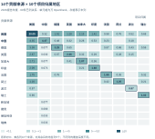

**图 2-6-7 贡献来源与项目归属地区的已列关系矩阵**

来源：报告编制组60条关系表，2026报告年度。单位：万OpenRank；本土单元格以边框标识，灰格为未列。

中国来源还出现在印度、德国、英国、加拿大、法国和波兰的项目记录中，其他来源也呈现多向参与。不同地区的协作不是只有单向“输出”或“接收”，项目归属与共同建设者所在地需同时保留。

中美目的地各列10个来源，其他目的地各列5个，因而灰格表示未列、不是零。支持多元参与，应从可进入的任务、可获得的反馈和明确的维护职责着手，而非单凭已列连接数评价。下一节转向这些合作的组织与规则基础。

## 2.7 全球开源治理与社会公益地图（G-Map）

*组织支持与共享规则，为持续合作提供条件*

开源协作不仅需要人和项目，还需要知道谁承担责任、如何加入、成果在什么条件下可以继续使用。本节从基金会项目、协作材料、许可采用与木兰实践展开，观察支持合作延续的组织和规则。

### 2.7.1 组织承载：规模扩展与影响累积节奏不同

基金会项目样本中，2022—2026年活跃仓库净增187个，其中157个集中在最近一年，约占84.0%；OpenRank份额由2.63%逐年升至2.93%。两项指标均提高，规模扩展与份额积累却有不同节奏。[38]

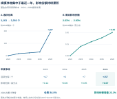

**图 2-7-1 基金会项目样本的规模、影响份额与年度增量**

来源：报告编制组归档，2022—2026报告年度。图线展示相对2022的累计增量，原始起止值单列；样本名单及份额分母待核验。

## 组织分工与协作入口：责任清楚，规则易得

Apache的公开治理文件将基金会共同服务、项目管理和贡献者工作分别安排：法律实体与基础设施提供共同支持，项目层面的技术方向、发布和社区事务依其治理规则处理。这为理解“组织承载”提供了具体而非抽象的例子。[41]

**图 2-7-2 Apache实践中的机构支持、项目管理与贡献参与**

依据Apache官方治理说明整理，查证于2026年11月5日；单一机构实践，不作治理评分。

明确职责之外，参与者还需要找到规则。GitHub 2025报告中，README、贡献指南与行为准则的覆盖分别约为63%、5.5%和2%。项目介绍与共同参与的入口，并不具有相同覆盖。[43]

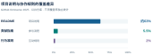

**图 2-7-3 GitHub公共仓库中项目说明与协作规则材料的覆盖**

来源：GitHub Octoverse 2025。三项覆盖率独立统计、可能重叠；文件存在不等于规则有效执行。

文件存在不等于规则有效执行，未检出也可能是材料位于网站或基金会文档。更有意义的检查是：入口是否清楚、内容对应哪个版本、谁回应问题、责任如何接续。

## 2.7.2 共享规则：规模排序与增长幅度并不相同

许可证说明他人可以怎样使用、修改和分发成果，是共享规则的重要入口。所列五种许可证的采用数量均增长，MIT与Apache-2.0保持规模前两位；BSD-3-Clause在2025年超过GPL-3.0。[39]

**图 2-7-4 所列五种许可证的采用规模、历史趋势与累计增幅**

来源：报告编制组归档，2022—2026报告年度。五条序列采用同一零起点纵轴；仅代表所列样本，不是全球完整许可排名。

2022—2026年，MIT、Apache-2.0与BSD-3-Clause分别增长24.2%、26.5%和51.5%。规模排序与增长幅度并不相同，但都不是条款优劣的排名。具体选择还需结合用途、依赖和分发方式。

本图保留同一零起点纵轴和每年的读数，避免用不同尺度夸大某类增长。它描述所列样本，不据此计算全球许可覆盖率，也不把历史报告中的不同范围统计拼入本表。

## 从许可名称到可核对的复用条件

许可名称不能替代具体条款。复用一个项目，仍需明确许可证版本、适用的代码或材料，以及分发或提供网络服务时触发的责任。下图以六种许可证概括若干关键条件，帮助读者找到核对入口。

**图 2-7-5 六种许可证的关键条件与适用场景**

依据OSI、ASF与SPDX官方文本概括，查证于2026年11月5日。图为阅读索引，不替代完整条款或具体适用判断。

MIT与BSD-3-Clause有相应声明要求；Apache-2.0还涉及明确的专利许可、修改说明及适用的NOTICE处理；GPL与AGPL分别涉及分发和修改后程序网络交互等场景下的对应源码义务。图中概括不替代完整条款及具体适用判断。[44][45][46][47][48]

将许可文本、第三方声明及依赖记录与发布版本关联，可以减少下游识别使用条件的困难。原统计中的GPL-3.0与AGPL-3.0未细分only和or-later，本章保留原字段，不补造更细的版本分布。

## 2.7.3 本土实践：采用扩展与项目影响分别计量

木兰宽松许可证样本中，2022—2026年累计活跃仓库由27个增至391个，项目OpenRank由689增至2,580，分别约为期初的14.5倍与3.7倍。采用范围与项目影响都在增加，但变化节奏不同。[40]

**图 2-7-6 木兰宽松许可证样本的累计采用与项目影响力**

来源：报告编制组归档，2022—2026报告年度。“累计活跃仓库”沿用原定义，不代表当年新建仓库；原表未分许可版本。

最近一年，仓库数增加51个、增长15.0%；项目OpenRank增加373、增长16.9%。较大的累计倍数需要与较小的期初基数并看，不能据此认定许可本身带来了技术质量提升。

MulanPSL-2.0有明确的专利授权、声明和双语条款，并列入OSI批准记录；原采用表未区分版本，不能将全部记录都认定为该版本。[49]

## 本章小结：从观察差异到识别支持需求

七幅地图呈现同一生态的不同侧面。参与规模在扩大，但活跃、贡献与项目影响并没有形成相同排序；项目有归属，贡献却可以跨越地域；代码、模型与数据持续积累，供给内容与使用结构也并不一致。将这些差异同时保留，比压成一个总分更能帮助识别实际需求。

### 参与与贡献：看见入口，也看见持续工作

活跃人数提供参与基础，贡献及其来源进一步揭示协作。公共部门和平台既应扩展可进入的机会，也应关注问题响应、代码审阅和维护能否延续。平台覆盖不同造成的可见性差异，尤其不宜被误读为参与力量不存在。

### 项目、人才与资产：把支持落实到具体对象

较高项目影响提示值得关注的协作节点，人才样本提示经验积累的地域差异，资产目录则呈现可复用供给。它们适合用于寻找项目、理解结构和提出问题；具体资源配置仍需核对真实需求、维护缺口和下游使用。

### 多样性与治理：把连接转化为可持续合作

不同地域和技术社区的参与，需要清楚的任务、反馈和规则入口。基金会支持与许可声明提供组织和使用条件，但数量、覆盖与采用并不替代执行。持续观察责任是否明确、问题能否被处理，比单独增加组织或文件更有意义。

面向不同主体的共同工作

| 行动主体 | 优先支持 | 后续观察 |
| --- | --- | --- |
| 公共部门与国际组织 | 结合参与盲区、真实项目与维护缺口配置支持，连接已有中心与成长社区。 | 是否形成持续任务与当地参与机会，而非只增加注册或发布数量。 |
| 基金会、企业与社区 | 支持评审、文档、安全更新和人员接续，使外部参与能够进入共同建设。 | 反馈是否及时，职责能否交接，许可与版本是否清楚。 |
| 高校、平台与研究机构 | 提供跨地区真实实践，维护可比的对象、来源与统计版本。 | 参与能否延续，资源是否可复用，数据变化能否复查。 |

第二章回答“参与和资源在哪里，结构有何不同”。下一章将把观察落到地区、企业、基金会与项目等主体，进一步考察它们在协作网络中的位置与变化，而不是重复宏观地图。

## 资料与方法：在各自范围内理解比较

本章采用GOSD归档、平台官方研究与规范文本三类互补资料。主统计期为**2025年7月1日至2026年6月30日**；历史快照与独立平台窗口按图说明。不同来源可以相互启发，但不因此成为同一个统计总体。

| 资料单元 | 实际范围 | 主要解释边界 |
| --- | --- | --- |
| 参与与活跃 | 2022—2026报告年度；GitHub地域表、五域表与本土平台补充分别使用。 | 不将不同覆盖相加为统一全球人数；净增不是首次参与。 |
| 贡献与项目影响 | 全球及省级图主要为2025自然年快照；五域与项目来源采用报告年度。 | 不跨表反推人均值、转化率或地域净输出。 |
| 高影响力人才 | 全球图为2026年7月快照；五域与固定十城为年度序列。 | 前5%的总体、窗口和并列规则待核；人数变化不是迁移。 |
| 代码、模型与数据 | 代码为年度活跃仓库；发布单位样本是日期待核的累计快照；任务记录采于2026年10月。 | 各类资产不相加；发布地不同于使用地，下载不等于独立用户。 |
| 外部平台观察 | GitHub 2026年报为截至9月底的年度窗，默认含公私仓；HF资料按各图原窗口。 | 不并入GOSD主期增长或分母；平台自报不改称自行测量。 |
| 治理与许可 | 三组独立归档序列；协作材料覆盖为2025平台观察；条款按明确版本核对。 | 不据有限样本推算全球覆盖，不将文件存在当作治理成效。 |

### 样本与归属

地域来自源表所用的位置或组织标签，不等于国籍。项目可能有多仓库、跨平台或基金会托管关系；采用当前公开标签不能自动还原历史归属。本章保留原始对象与数值，并对样本之外、未知与未列分别处理。

### 两套贡献关系，分别回答各自问题

2.2的中美来源前十表含20条记录，并保留完整样本的原始份额；2.6的扩展关系表含60条记录、14个来源和10个目的地。二者覆盖不同，不能用差额判断增长，也不能相互填补未列关系。2.6的内部来源构成对照则明确复用2.2的前十表。

## 条件估算、核查与复现

### 技术结构估算：明确假设，保留已知总量

2.5的分类下钻以GOSD 2025技术图表的12类项目数量为基准。设第$i$类记录数为$n_i$，结构比例为$p_i=n_i/\sum_j n_j$，则结构延续估计为： $$\widehat{N}_{i,t}=p_i N_t,\qquad
\widehat{\Delta N_i}=p_i(N_{2026}-N_{2025}).$$ 其中$N_t$是已知的GitHub活跃仓库总量。由项目分类比例映射仓库数量，假设样本能够外推、类别互斥且覆盖完整，这些条件尚未验证。因此估计用于观察假设下的结构，不是实测类别统计。

AI敏感性分析将该类增长率分别设为20%、30%、40%，其他类别按共同增幅平衡总量。若AI期初规模为$A_{2025}$、设定增长率为$g$，其余类别的平衡增长率为： $$g_{\mathrm{other}}=
 \frac{N_{2026}-A_{2025}(1+g)}{N_{2025}-A_{2025}}-1.$$ 三个参数是情景假设，不是置信区间、官方预测或实际增速排序。详细未舍入值与计算程序随结构化源保存。

### 数值复算与上游核验分别记录

本次整章工作核对了归档文件、派生计算、图表读数及文字对应关系，未重新运行全平台OpenRank或账号级去重。原材料中尚缺的生产记录，包括部分地域估计方法、项目历史映射、人才筛选、发布单位样本日期、基金会名单与许可识别规则，继续列入核查清单。

这些缺项约束的是依赖它们的具体判断，不改变已展示表中数值的来源，也不允许将图形完善视为数据认证。正文保留必要范围提示，较长的查询、文件指纹、版本差异和逐项待核状态放入配套记录。

### 如何使用这些结果

本章适合用来理解参与结构、寻找协作节点并确定后续调查对象。对政策效果、人才能力、项目质量和实际采用的判断，仍需结合相应对象的具体证据。将不同层面的观察并列，有助于避免由单项规模指标承担超出其定义的结论。

## 参考资料

[1] GOSD编制组．全球开发者与活跃开发者报告年度归档，2022—2026．OpenDigger／OpenShare来源记录，版本c51e344。 [来源入口](https://github.com/X-lab2017/2026-Global-Open-Source-Development-Report/blob/c51e3441361407b68f10b339d97eff288319b503/preview/content/vmap/source/README.md)

[2] GOSD编制组．五域开发者总量与活跃开发者序列，2022—2026报告年度．版本c51e344。 [来源入口](https://github.com/X-lab2017/2026-Global-Open-Source-Development-Report/blob/c51e3441361407b68f10b339d97eff288319b503/data/processed/chapter2/fig-2-1-3_five_region_active_developers_trend.csv)

[3] GOSD编制组．本土平台补充量与覆盖比较说明，2026-10-20．版本c51e344。 [来源入口](https://github.com/X-lab2017/2026-Global-Open-Source-Development-Report/blob/c51e3441361407b68f10b339d97eff288319b503/preview/docs/vmap-publication-revision-20261020.md)

[4] GOSD编制组．中国34个省级地区总量、活跃与同比增量．版本c51e344。 [来源入口](https://github.com/X-lab2017/2026-Global-Open-Source-Development-Report/blob/c51e3441361407b68f10b339d97eff288319b503/preview/content/vmap/fig-2-1-3_china-provinces.csv)

[5] GitHub．Octoverse 2026: Commits, pushes, reach new highs in 2026 as developers build with agents．2026-10-28。 [来源入口](https://github.blog/news-insights/octoverse/octoverse-commits-pushes-reach-new-highs-in-2026-as-developers-build-with-agents/)

[6] OpenDigger. 指标使用指南；活跃度与贡献者指标说明. 2026-11-05核对. [来源入口](https://open-digger.cn/docs/user-docs/metrics/metrics-usage-guide)

[7] GOSD编制组．C-Map国家贡献与活跃快照，2025年．236个地域记录，版本c51e344。 [来源入口](https://github.com/X-lab2017/2026-Global-Open-Source-Development-Report/blob/c51e3441361407b68f10b339d97eff288319b503/preview/content/cmap/countries.csv)

[8] GOSD编制组. 五域开发者OpenRank贡献度序列，2022—2026报告年度. [来源入口](https://github.com/X-lab2017/2026-Global-Open-Source-Development-Report/blob/c51e3441361407b68f10b339d97eff288319b503/data/processed/chapter2/fig-2-2-2_five_region_openrank_contribution_trend.csv)

[9] GOSD编制组．中国34个省级地区贡献与活跃快照，2025年．版本c51e344。 [来源入口](https://github.com/X-lab2017/2026-Global-Open-Source-Development-Report/blob/c51e3441361407b68f10b339d97eff288319b503/preview/content/cmap/provinces.csv)

[10] GOSD编制组. 中美项目贡献来源前十表及方法说明，2026报告年度. 20条关系，14个来源国家. [来源入口](https://github.com/X-lab2017/2026-Global-Open-Source-Development-Report/blob/c51e3441361407b68f10b339d97eff288319b503/preview/content/cmap/flow-method.md)

[11] GOSD编制组. 2.2图文与出版修订记录，2026-10-20. 地理快照、五域表及独立平均贡献样本分别保留. [来源入口](https://github.com/X-lab2017/2026-Global-Open-Source-Development-Report/blob/c51e3441361407b68f10b339d97eff288319b503/preview/docs/cmap-publication-revision-20261020.md)

[12] OpenDigger. 社区OpenRank贡献度. 项目内协作网络定义与实现入口，2026-11-05核对. [来源入口](https://open-digger.cn/docs/user-docs/metrics/community-openrank)

[13] OpenDigger. 全域OpenRank影响力. 开发者—仓库协作网络及历史继承机制，2026-11-05核对. [来源入口](https://open-digger.cn/docs/user-docs/metrics/global-openrank)

[14] GOSD编制组．I-Map地域与企业影响力归档，2025自然年．版本c51e344。 [来源入口](https://github.com/X-lab2017/2026-Global-Open-Source-Development-Report/blob/c51e3441361407b68f10b339d97eff288319b503/preview/content/imap/influence.json)

[15] GOSD编制组. 五域项目影响力与开发者贡献度，2022—2026报告年度. 原稿数据组合保留. [来源入口](https://github.com/X-lab2017/2026-Global-Open-Source-Development-Report/blob/c51e3441361407b68f10b339d97eff288319b503/preview/content/imap/observations.json)

[16] GOSD编制组. 2.3 I-Map出版修订记录，2026-10-20. 记录自然年与报告年度的版本差异. [来源入口](https://github.com/X-lab2017/2026-Global-Open-Source-Development-Report/blob/c51e3441361407b68f10b339d97eff288319b503/preview/docs/imap-publication-revision-20261020.md)

[17] OpenDigger. 项目标签：OpenHarmony、openEuler、AgentScope；基金会关联标签. 固定提交5c2ffc4；逐文件入口见来源清单. [来源入口](https://github.com/X-lab2017/open-digger/blob/5c2ffc4f5b3dd37ebcb20514c7abfee6853bd830/labeled_data/companies/huawei/openharmony.yml)

[18] OpenDigger. chinaAnnualReport.ts：项目、发起方与基金会分别识别的公开示例. 示例年份为2024，不等同本报告生产记录. [来源入口](https://github.com/X-lab2017/open-digger/blob/5c2ffc4f5b3dd37ebcb20514c7abfee6853bd830/src/dataProduction/chinaAnnualReport.ts)

[19] GOSD编制组．全球高影响力人才地域表，2026年7月快照．前5%定义沿用源表，筛选方法待核。 [来源入口](https://github.com/X-lab2017/2026-Global-Open-Source-Development-Report/blob/c51e3441361407b68f10b339d97eff288319b503/preview/content/tmap/fig-2-4-1_global_open_source_talent_map.csv)

[20] GOSD编制组. 五域高影响力人才序列，2022—2026报告年度。 [来源入口](https://github.com/X-lab2017/2026-Global-Open-Source-Development-Report/blob/c51e3441361407b68f10b339d97eff288319b503/preview/content/tmap/fig-2-4-2_five_region_open_source_talent_trend.csv)

[21] GOSD编制组. 中国固定十城人才序列及人数表，2022—2026报告年度。 [来源入口](https://github.com/X-lab2017/2026-Global-Open-Source-Development-Report/blob/c51e3441361407b68f10b339d97eff288319b503/preview/content/tmap/fig-2-4-4_china_top10_city_talent_trend.csv)

[22] GOSD编制组．四平台活跃仓库年度序列，2022—2026报告年度．固定版本c51e344。 [来源入口](https://github.com/X-lab2017/2026-Global-Open-Source-Development-Report/blob/c51e3441361407b68f10b339d97eff288319b503/data/processed/chapter2/fig-2-7-1_platform_active_repository_trend.csv)

[23] OpenDigger／GOSD 2025．Technology-Domain Bubble Chart Analysis．12类项目数量及影响力，版本5c2ffc4。 [来源入口](https://github.com/X-lab2017/open-digger/blob/5c2ffc4f5b3dd37ebcb20514c7abfee6853bd830/notebook/GOSD2025/Chapter2_Global%20Open%20Source%20Observatory/2.3.3_Technology-Domain%20Bubble%20Chart%20Analysis.html)

[24] Hugging Face．State of Open Models: Summer 2026 Observations，2026-08-14．固定文本9e982d5。 [来源入口](https://github.com/huggingface/blog/blob/9e982d5f2ff0c93248a897bf1e0c59c9828c5ab8/state-of-open-models-summer-2026.md)

[25] GOSD编制组．A-Map发布单位累计样本，observations.json．快照日期未注明，版本c51e344。 [来源入口](https://github.com/X-lab2017/2026-Global-Open-Source-Development-Report/blob/c51e3441361407b68f10b339d97eff288319b503/preview/content/amap/observations.json)

[26] GOSD归档数据服务．模型任务分布modelTasks.json，采集于2026-10-15。 [来源入口](https://github.com/X-lab2017/2026-Global-Open-Source-Development-Report/blob/c51e3441361407b68f10b339d97eff288319b503/preview/content/amap/modelTasks.json)

[27] Hugging Face．Models Download Stats．下载计数规则；访问于2026-11-05。 [来源入口](https://huggingface.co/docs/hub/models-download-stats)

[28] Hugging Face．Dataset Cards．数据说明与任务标签；访问于2026-11-05。 [来源入口](https://huggingface.co/docs/hub/datasets-cards)

[29] GOSD归档数据服务．数据集任务分布datasetTasks.json，采集于2026-10-15。 [来源入口](https://github.com/X-lab2017/2026-Global-Open-Source-Development-Report/blob/c51e3441361407b68f10b339d97eff288319b503/preview/content/amap/datasetTasks.json)

[30] Hugging Face．State of Open Source on Hugging Face: Spring 2026，2026-03-17．机器人数据集历史观察。 [来源入口](https://huggingface.co/blog/huggingface/state-of-os-hf-spring-2026)

[31] Hugging Face．Datasets Download Stats．数据集下载计数规则；访问于2026-11-05。 [来源入口](https://huggingface.co/docs/hub/datasets-download-stats)

[32] Hugging Face．Model Cards．模型用途、局限与使用条件；访问于2026-11-05。 [来源入口](https://huggingface.co/docs/hub/model-cards)

[33] GOSD研究组．GitHub与人机协作开发证据研究；HF与模型生态材料深度研究，2026-11-04．本轮研究输入。 [来源入口](https://github.com/will-ww/2026-GOSD-Report/tree/65a5fbda5c9192a11328ed9926959a0f0c5dc8f1/docs/research/2026-11-04)

[34] GOSD编制组. 固定五国与其他国家贡献份额序列，2022—2026报告年度。 [来源入口](https://github.com/X-lab2017/2026-Global-Open-Source-Development-Report/blob/c51e3441361407b68f10b339d97eff288319b503/preview/content/dmap/source/fig-2-5-1_country_contribution_share_trend.csv)

[35] GOSD编制组. 中美项目贡献来源前十表，独立样本。 [来源入口](https://github.com/X-lab2017/2026-Global-Open-Source-Development-Report/blob/c51e3441361407b68f10b339d97eff288319b503/preview/content/dmap/source/table-2-5-1_china_us_project_contribution_top10.csv)

[36] GOSD编制组. 跨地域项目贡献关系表，60条已列关系。 [来源入口](https://github.com/X-lab2017/2026-Global-Open-Source-Development-Report/blob/c51e3441361407b68f10b339d97eff288319b503/preview/content/dmap/source/fig-2-5-2_cross_border_project_contribution_flow.csv)

[37] GOSD编制组. D-Map来源清单、样本定义与缺项记录。 [来源入口](https://github.com/X-lab2017/2026-Global-Open-Source-Development-Report/blob/c51e3441361407b68f10b339d97eff288319b503/preview/content/dmap/source-manifest.json)

[38] GOSD编制组. 基金会项目影响份额与活跃仓库序列，2022—2026。 [来源入口](https://github.com/X-lab2017/2026-Global-Open-Source-Development-Report/blob/c51e3441361407b68f10b339d97eff288319b503/data/processed/chapter2/fig-2-6-1_foundation_share_and_active_repositories.csv)

[39] GOSD编制组. 所列五种许可证的活跃仓库序列，2022—2026。 [来源入口](https://github.com/X-lab2017/2026-Global-Open-Source-Development-Report/blob/c51e3441361407b68f10b339d97eff288319b503/data/processed/chapter2/fig-2-6-2_active_repository_license_trend.csv)

[40] GOSD编制组. 木兰宽松许可证累计活跃仓库与项目影响力序列。 [来源入口](https://github.com/X-lab2017/2026-Global-Open-Source-Development-Report/blob/c51e3441361407b68f10b339d97eff288319b503/data/processed/chapter2/fig-2-6-3_mulan_permissive_license_trend.csv)

[41] Apache Software Foundation. How the ASF Works，访问于2026-11-05。 [来源入口](https://apache.org/foundation/how-it-works/)

[42] GOSD编制组. G-Map来源清单；原表样本、统计窗口与复现状态。 [来源入口](https://github.com/X-lab2017/2026-Global-Open-Source-Development-Report/blob/c51e3441361407b68f10b339d97eff288319b503/preview/content/gmap/source-manifest.json)

[43] GitHub. Octoverse 2025，Community health及Methodology；2025-10-28，页面2026-02更新。 [来源入口](https://github.blog/news-insights/octoverse/octoverse-a-new-developer-joins-github-every-second-as-ai-leads-typescript-to-1/)

[44] Open Source Initiative. The MIT License，原文。 [来源入口](https://opensource.org/license/mit)

[45] Open Source Initiative. The 3-Clause BSD License，原文。 [来源入口](https://opensource.org/license/bsd-3-clause)

[46] Apache Software Foundation. Apache License, Version 2.0，第3—4条。 [来源入口](https://www.apache.org/licenses/LICENSE-2.0)

[47] SPDX. GNU General Public License v3.0 only，原文第5—6条。 [来源入口](https://spdx.org/licenses/GPL-3.0-only.html)

[48] SPDX. GNU Affero General Public License v3.0 only，原文第13条。 [来源入口](https://spdx.org/licenses/AGPL-3.0-only.html)

[49] Open Source Initiative. Mulan Permissive Software License v2，原文及批准记录。 [来源入口](https://opensource.org/license/MulanPSL-2.0)
